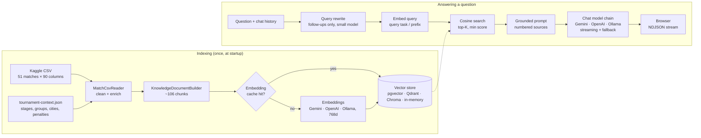

# ⚽ Euro 2024 RAG

A ChatGPT-style assistant that answers questions about **UEFA Euro 2024** using **Retrieval-Augmented Generation**.
Built with **.NET 10**, **Microsoft.Extensions.AI**, a **pluggable LLM provider** (**Google Gemini**, **OpenAI** or local models via **Ollama**, chosen in configuration), a **pluggable vector store** (**PostgreSQL + pgvector**, **Qdrant**, **Chroma** or in-memory, chosen in configuration), **Polly** and a small **jQuery** front end.

> Ask *"Who won Euro 2024 and how did they get there?"*, *"Türkiye turnuvada nasıl bir performans gösterdi?"* or *"Which team over-performed its xG the most?"*. The app retrieves the relevant documents, shows them with similarity scores, and streams an answer that cites them.

## Features

- **End-to-end RAG pipeline**: CSV → documents → embeddings → vector store → retrieval → grounded, streamed generation.
- **Chunking designed around the questions people ask**: match reports, plus pre-computed team summaries, group tables, venues and leaderboards, so aggregate questions work as well as single-match ones.
- **Query rewriting for follow-ups**: "and what about their defence?" becomes a standalone English search query, generated by a cheap Flash-Lite model.
- **Asymmetric embeddings**: Gemini task types (`RETRIEVAL_DOCUMENT` vs `RETRIEVAL_QUERY`) or document/query prefixes for open models, always 768 dimensions.
- **Citations**: every answer cites its sources as `[n]`; click a citation to open the source and see its similarity score.
- **Model fallback chain with Polly**: `gemini-3.8-flash` → `gemini-3.5-flash` → `gemini-3.7-flash` → `gemini-3.6-flash`, with retries, timeouts, daily-quota detection and a streaming-aware fallback.
- **Embedding cache on disk**: restarts don't re-embed unchanged documents.
- **Config-driven LLM provider**: `Ai:Provider` = `Gemini`, `OpenAI` or `Ollama`; embeddings can come from another provider (`Ai:EmbeddingProvider`). See [Choosing an LLM provider](#choosing-an-llm-provider).
- **Config-driven vector database**: `VectorStore:Provider` = `InMemory`, `PgVector`, `Qdrant` or `Chroma`. pgvector and Qdrant use the .NET Community Toolkit providers; Chroma has no `Microsoft.Extensions.VectorData` provider, so the repo includes a small one over Chroma's REST API.
- **Provider-agnostic core**: the RAG code only depends on `IChatClient`, `IEmbeddingGenerator` and `VectorStoreCollection`, so the LLM provider or the vector store can be swapped without touching it.

## Architecture



## How the RAG pipeline works

### 1. Ingestion and chunking

Vector search returns the *K most similar* chunks. That is great for *"What happened in Spain vs Germany?"* (one match chunk answers it), but it cannot sum 51 rows to answer *"Which team scored the most goals?"*. So the aggregations are computed in C# during ingestion and stored as their own chunks:


| Kind          | Count | Example question it answers                  |
| ------------- | ----- | -------------------------------------------- |
| `match`       | 51    | "Compare the stats of the final."            |
| `team`        | 24    | "How did Turkiye do?"                        |
| `group`       | 6     | "Show me the Group F table."                 |
| `venue`       | 10    | "Which matches were played in Berlin?"       |
| `leaderboard` | 13    | "Which team received the most yellow cards?" |
| `tournament`  | 2     | "Which matches ended 0–0?"                  |

Each chunk is written in natural language, with a descriptive first sentence ("UEFA Euro 2024 match report — Match 51 of 51: Spain vs England (Final)"), because that sentence largely decides what the embedding "means".

### 2. Embeddings

- Model: `gemini-embedding-001` by default, truncated to **768 dimensions** (Matryoshka representation), which is plenty for ~100 chunks. The OpenAI (`text-embedding-3-small`, truncated) and Ollama (`embeddinggemma`, native 768) defaults use the same size, so the vector store schema never changes.
- Documents and questions are embedded differently. The RAG code only marks what is being embedded (`EmbeddingTasks.ForDocuments` / `ForQuery`); `TaskAwareEmbeddingGenerator` turns that into what the provider understands: Gemini task types `RETRIEVAL_DOCUMENT` / `RETRIEVAL_QUERY` (through `EmbeddingGenerationOptions.RawRepresentationFactory`, since Microsoft.Extensions.AI has no task-type concept), or the text prefixes an open model was trained with (`DocumentPrefix` / `QueryPrefix`). It also fails with a clear message if a model returns a different number of dimensions.
- Embeddings are cached in one file per embedding model, e.g. `App_Data/embedding-cache.gemini-gemini-embedding-001.json`, keyed by `sha256(provider:model | dimensions | text)`. Changing a chunk's text re-embeds only that chunk. A new embedding model embeds everything once; switching back to a model used before loads its file again.

### 3. Retrieval

- Store: any `VectorStoreCollection<Guid, KnowledgeChunk>`; see [Choosing a vector database](#choosing-a-vector-database).
- Similarity: cosine, top **8**, results below **0.5** are dropped (`Rag:TopK`, `Rag:MinScore`). Each embedding model has its own score scale, so the embedding provider can override the threshold (`Ai:<Provider>:MinScore`: OpenAI `0.4`, Ollama `0.35`).
- **Query rewriting** (`Rag:QueryRewrite` = `FollowUps` by default): a follow-up is rewritten into a standalone English query using the conversation. After a question about Turkiye, *"Peki elendikleri maçta rakibe göre xG'leri nasıldı?"* becomes *"Turkiye vs Netherlands quarter final match xG stats Euro 2024"*. A first question is searched as-is: the default embedding models are multilingual, so the Turkish *"Türkiye turnuvada nasıl bir performans gösterdi?"* already retrieves the Turkiye team summary, all five Turkiye matches and the Group F table. Rewriting runs on its own chain of small models (`Ai:<Provider>:RewriteModels`, e.g. Flash-Lite), which is faster and, on the Gemini free tier, uses its own quota. If the rewrite fails, the raw question is used.
- `GET /api/search?q=...` returns the raw retrieval results, which helps when tuning chunking.

### 4. Generation

The model gets a system prompt that restricts it to the numbered sources, asks for `[n]` citations and tells it to answer in the user's language. The answer is streamed to the browser as NDJSON:

```
{"type":"query","text":"Spain path to the title Euro 2024 champions"}
{"type":"sources","data":[{"index":1,"id":"team-spain","kind":"team","score":0.81,...}]}
{"type":"delta","text":"Spain won the tournament"}
...
{"type":"done","data":{"model":"gemini-3.8-flash","elapsedMs":2140,"inputTokens":3120,"outputTokens":210}}
```

If the stream breaks after text has been sent, the answer is regenerated once: the server sends `{"type":"reset"}` and the browser discards the partial text.

## Choosing an LLM provider

`RagService` and `IngestionService` only see `IChatClient` and `IEmbeddingGenerator<string, Embedding<float>>` from `Microsoft.Extensions.AI`. `Ai/AiServiceCollectionExtensions.cs` is the one place that knows the concrete SDKs; it reads `Ai:Provider` (chat + query rewriting) and `Ai:EmbeddingProvider` (empty = same as `Ai:Provider`) and creates the matching clients:

| `Ai:Provider`      | SDK                                                   | Default chat → rewrite models                       | Default embedding model                   |
| ------------------ | ----------------------------------------------------- | --------------------------------------------------- | ----------------------------------------- |
| `Gemini` (default) | `Google.GenAI`                                        | `gemini-3.8-flash` … → `gemini-3.5-flash-lite` …     | `gemini-embedding-001` (truncated to 768) |
| `OpenAI`           | `Microsoft.Extensions.AI.OpenAI` (official `OpenAI`)  | `gpt-5.4-mini`, `gpt-4.1-mini` → `gpt-5.4-nano`, `gpt-4.1-nano` | `text-embedding-3-small` (truncated to 768) |
| `Ollama`           | `OllamaSharp`                                         | `gemma3:4b` (rewrite uses the chat models)          | `embeddinggemma` (768, multilingual)      |

Each provider has its own section under `Ai` with the same model settings (`ChatModels`, `RewriteModels`, `EmbeddingModel`, `DocumentPrefix`, `QueryPrefix`, `SupportsTemperature`, `AttemptTimeout`) plus its connection settings. Only the sections of the selected providers are read, so all three can stay configured side by side.

Switch with `appsettings.Development.json`, an environment variable (`Ai__Provider=Ollama`) or the command line:

```bash
dotnet run --project src/Euro2024Rag.Web -- --Ai:Provider Ollama
```

Things that differ between the providers, and how the demo handles them:

- **Embedding space.** Vectors from different models can't be compared, so the embedding model never falls back, and each embedding model has its own cache file. After switching the embedding provider the index is re-embedded at startup (or loaded from that model's cache) and every chunk is upserted again (same deterministic keys), so persistent vector stores are overwritten in place. The model must produce 768 dimensions (or truncate to it): Gemini and OpenAI `text-embedding-3-*` truncate, `embeddinggemma` and `nomic-embed-text` are 768 natively.
- **Asymmetric embeddings.** Gemini has task types; open models use prefixes instead. The Ollama defaults are `embeddinggemma`'s prompts (`title: none | text: ` / `task: search result | query: `); for `nomic-embed-text` use `search_document: ` / `search_query: `.
- **Mixing providers.** `"Provider": "Ollama", "EmbeddingProvider": "Gemini"` answers with a local model while keeping Gemini embeddings (and their cache).
- **Temperature.** OpenAI reasoning models (gpt-5.x, o-series) reject any temperature but the default, so `Ai:OpenAI:SupportsTemperature` is `false` and the request leaves it out.
- **Errors.** Each SDK reports HTTP errors differently (`ApiException`, `ClientResultException`, `HttpRequestException` / `OllamaException`); `AiErrors` maps them all to the same retry / fallback decisions. An Ollama model that hasn't been pulled counts as "model not found" and falls back like a 404.
- **Timeouts and batch size.** A local model may need many seconds to load before the first token, so `Ai:Ollama:AttemptTimeout` (90 s) overrides the global 15 s. On a CPU an embedding model handles only a few documents per minute, so `Ai:Ollama:EmbeddingBatchSize` (5) overrides `Rag:EmbeddingBatchSize` (25); otherwise a batch would time out and be retried without progress.
- **Score scale.** Every embedding model scores similarity on its own scale: for the same relevant chunks Gemini gives ~0.6–0.75, `text-embedding-3-small` ~0.4–0.65 and `embeddinggemma` ~0.35–0.6. A single `Rag:MinScore` of 0.5 would drop most of them for OpenAI and Ollama, so `Ai:OpenAI:MinScore` (0.4) and `Ai:Ollama:MinScore` (0.35) override it whenever that provider does the embedding.

### OpenAI

Put the key in `appsettings.Development.json` (`"Ai": { "OpenAI": { "ApiKey": "sk-..." } }`) or `Ai__OpenAI__ApiKey`, then set `Ai:Provider` to `OpenAI`. `Ai:OpenAI:Endpoint` points the same client at any OpenAI-compatible API instead: Azure OpenAI (`https://<resource>.openai.azure.com/openai/v1/`, model names = deployment names), LM Studio, vLLM, or Ollama's own `http://localhost:11434/v1/`. The key can be left empty for local servers.

### Ollama (local models)

Install [Ollama](https://ollama.com/download) (native install uses the GPU on macOS), or run `docker compose up -d ollama`, and pull the models once:

```bash
ollama pull gemma3:4b
```

```bash
ollama pull embeddinggemma
```

(With Docker: `docker compose exec ollama ollama pull …`. Docker Desktop on macOS can't use the GPU, so there the first indexing run takes ~10 minutes on 4 CPUs instead of seconds; the embedding cache makes later starts instant.) Then start the app with `--Ai:Provider Ollama`. No API key or quota; answers are slower and less precise than the hosted models: the default `gemma3:4b` fits small machines but misreads numbers in the sources now and then. If your machine can run it, use a bigger model: `gemma4:12b` (~8 GB) or, with more memory, `gemma4:26b` (~16–19 GB, a mixture-of-experts model that is fast for its size). Pull it and set `Ai:Ollama:ChatModels`, e.g. `--Ai:Ollama:ChatModels:0 gemma4:12b`. On Docker Desktop, give the VM enough memory for the chat model plus `embeddinggemma`.

## Choosing a vector database

`RagService` and `IngestionService` only see `VectorStoreCollection<Guid, KnowledgeChunk>` from `Microsoft.Extensions.VectorData`. `VectorStores/VectorStoreServiceCollectionExtensions.cs` is the one place that knows the concrete databases; it reads `VectorStore:Provider` and creates the matching collection:

| `VectorStore:Provider` | Implementation                                                 | Storage                              |
| ---------------------- | -------------------------------------------------------------- | ------------------------------------ |
| `InMemory` (default)   | `InMemoryCollection` (`CommunityToolkit.VectorData.InMemory`)  | Process memory, rebuilt every start  |
| `PgVector`             | `PostgresCollection` (`CommunityToolkit.VectorData.PgVector`)  | Table `euro2024`, `vector(768)` column |
| `Qdrant`               | `QdrantCollection` (`CommunityToolkit.VectorData.Qdrant`)      | Collection `euro2024`, cosine, gRPC  |
| `Chroma`               | `ChromaKnowledgeCollection` (in this repo, Chroma v2 REST API) | Collection `euro2024`, `hnsw.space = cosine` |

The collection schema comes from the attributes on `KnowledgeChunk` (`[VectorStoreKey]`, `[VectorStoreData]`, `[VectorStoreVector(768, CosineSimilarity)]`), so pgvector and Qdrant create their table / collection and payload indexes from the same class.

Things that differ between the databases, and how the demo handles them:

- **Key type.** Qdrant only accepts `Guid` or `ulong` point ids, so the record key is a `Guid` derived from the readable chunk id (`team-spain` → always the same Guid, `KnowledgeChunk.CreateKey`). Re-indexing therefore overwrites records instead of duplicating them, and the readable id is kept as a data field.
- **Chroma has no `Microsoft.Extensions.VectorData` provider** (the Semantic Kernel Chroma package only implements the old memory-store API). `ChromaKnowledgeCollection` derives from `VectorStoreCollection<Guid, KnowledgeChunk>` and implements upsert, get, delete, vector search and collection management over HTTP. Filtered search is not implemented: the pipeline doesn't use it. Chroma metadata values must be scalars, so the team list is stored as one `|`-separated string.
- **Scores.** Chroma returns cosine *distance*; it is converted to similarity (`1 − distance`) so `Rag:MinScore` means the same thing everywhere. pgvector and Qdrant return similarity directly for `DistanceFunction.CosineSimilarity`.
- **pgvector extension.** The `pgvector/pgvector` image ships the extension but doesn't enable it; `docker/pgvector-init.sql` runs `CREATE EXTENSION vector` on first start. With ~100 rows pgvector does an exact scan; set `IndexKind = IndexKind.Hnsw` on the vector property for an HNSW index on larger data (the in-memory store only supports flat search).

With the same embeddings, all four return the same chunks in the same order with the same scores (to 4 decimals) for the example questions. Indexing still runs at startup for every provider: it reads embeddings from the disk cache and upserts all chunks, which is idempotent thanks to the deterministic keys. Chunks that are removed from the dataset are not deleted from a persistent store; drop the collection (or `docker compose down -v`) after changing the chunking.

### Running with a vector database

`docker-compose.yml` defines the three databases; start the one you want:

```bash
docker compose up -d qdrant
```

Then select it, in `appsettings.Development.json` (`"VectorStore": { "Provider": "Qdrant" }`), as an environment variable (`VectorStore__Provider=Qdrant`) or on the command line:

```bash
dotnet run --project src/Euro2024Rag.Web -- --VectorStore:Provider Qdrant
```

| Service    | Port                     | Default connection settings                                                              |
| ---------- | ------------------------ | ---------------------------------------------------------------------------------------- |
| `pgvector` | 5432                     | `Host=localhost;Port=5432;Username=postgres;Password=postgres;Database=euro2024`         |
| `qdrant`   | 6334 (gRPC), 6333 (REST) | `localhost:6334`; dashboard at http://localhost:6333/dashboard                            |
| `chroma`   | 8000                     | `http://localhost:8000`, `default_tenant` / `default_database`                           |

`/api/status` reports the active provider, and the UI header shows it. If the database is unreachable, indexing fails with the connection error in the status message and the chat stays disabled.

## Resilience: model fallback chain with Polly

The provider SDKs only retry HTTP calls on the same model (the OpenAI SDK's own retries are turned off so Polly is the single owner); none of them has model fallback. `ResilientChatClient` adds one with Polly v8 while still being a plain `IChatClient`, for every provider. It takes an ordered list of models and builds one pipeline per model, whose Fallback strategy hands over to the next one:

```
gemini-3.8-flash:  Fallback (→ next model) └─ Retry (2×, exponential + jitter) └─ Timeout (15 s)
gemini-3.5-flash:  Fallback (→ next model) └─ Retry └─ Timeout
gemini-3.7-flash:  Fallback (→ next model) └─ Retry └─ Timeout
gemini-3.6-flash:                           Retry └─ Timeout     ← last model, errors surface to the UI
```


| Failure                                                          | Retry same model                   | Fall back                    |
| ---------------------------------------------------------------- | ---------------------------------- | ---------------------------- |
| 429 per-minute rate limit, 5xx, timeout, network, stream cut off | ✅                                 | ✅ after retries             |
| 429 **quota** exhausted (Gemini `…PerDay…`, OpenAI `insufficient_quota`) | ❌ won't recover soon      | ✅ immediately               |
| 404 unknown or retired model id, Ollama model not pulled         | ❌                                 | ✅ immediately               |
| 400 / 401 / 403 bad request or API key                           | ❌                                 | ❌ (would fail on any model) |

**Streaming** can only fall back before the user sees any text. The pipeline wraps "open the stream and read until the first *visible* content"; thinking models can send empty or reasoning-only chunks first, and those are buffered rather than counted as a successful start. If a stream breaks after visible text, `RagService` regenerates the answer once and tells the browser to reset.

**Embeddings are retried but never fall back**: a different embedding model produces vectors in a different space that can't be compared with the index. Free-tier embedding quotas are per minute, so a 429 waits 15 → 60 s instead of a few seconds, and the embedding cache is saved after every batch so an interrupted indexing run resumes where it stopped.

### Free tier notes

On the Gemini API free tier, quotas are **per project and per model** (for example `gemini-3.8-flash` allowed 20 requests per day when this was built), and daily quotas reset at midnight Pacific time. That is why the chain has several models, and why query rewriting is limited to follow-ups and runs on separate Flash-Lite models. Check your limits in [AI Studio](https://aistudio.google.com/rate-limit). Popular models can also return 503 "high demand" for a while; the chain handles this, but answers are slower when it does.

## The dataset

[Euro 2024 Matches](https://www.kaggle.com/datasets/thamersekhri/euro-2024-matches) by Thamer Sekhri, licensed under [CC BY-SA 4.0](https://creativecommons.org/licenses/by-sa/4.0/): one row per match (51) with ~45 team statistics per side (xG, shots, passes, duels, cards…). It has **no player names, goal scorers, minutes or dates**, and the assistant says so when asked.

Data quality issues found and handled in `MatchCsvReader`:

- Stadium names lost their non-ASCII characters (`Fuball Arena Mnchen`); they are mapped back to the real names and host cities.
- Several stats appear twice under slightly different headers (`Total shots` / `Total shots.`); the first one is used.
- `Accurate passes` is copied from other rows (e.g. Hungary: 438 passes, 643 accurate), so it is ignored.
- There is no stage or group column. Rows are chronological, so stage is derived from the row number.

`Data/tournament-context.json` adds a small set of facts the CSV lacks: stage boundaries, groups, host cities and which knockout matches went to extra time or penalties. Without it, *"Who won Portugal vs France?"* would only show a 0–0 draw.

## Getting started

**Prerequisites:** [.NET 10 SDK](https://dotnet.microsoft.com/download), plus **one** LLM provider. None of them is required; pick whichever you have:

| Provider | You need | Cost | Speed / quality |
| -------- | -------- | ---- | --------------- |
| **Ollama** | [Ollama](https://ollama.com/download) installed, no account | Free, runs locally | Slower, smaller models |
| **Gemini** (default) | A key from [Google AI Studio](https://aistudio.google.com/apikey) | Free tier | Fast, best answers in this demo |
| **OpenAI** | A key from [platform.openai.com](https://platform.openai.com/api-keys) with credit, or any [OpenAI-compatible API](#openai) | Paid | Fast |

Docker is only needed for pgvector, Qdrant, Chroma or a containerized Ollama.

### Option A: Ollama (local, no account, no API key)

1. Pull the models (once):

   ```bash
   ollama pull gemma3:4b
   ```

   ```bash
   ollama pull embeddinggemma
   ```
2. Run the app with Ollama selected:

   ```bash
   dotnet run --project src/Euro2024Rag.Web -- --Ai:Provider Ollama
   ```

   To make it permanent, put `"Ai": { "Provider": "Ollama" }` in `src/Euro2024Rag.Web/appsettings.Development.json`, or set `Ai__Provider=Ollama`.

With a GPU (or Apple silicon, native install) the first start takes well under a minute; on a CPU only (e.g. Ollama in Docker on macOS) embedding the ~106 chunks takes ~10 minutes once, later starts load them from the cache. See [Ollama (local models)](#ollama-local-models).

### Option B: Gemini or OpenAI (API key)

1. Create `appsettings.Development.json`, which is git-ignored, from the example:

   ```bash
   cp src/Euro2024Rag.Web/appsettings.Development.example.json src/Euro2024Rag.Web/appsettings.Development.json
   ```

   Set `Ai:Provider` to `Gemini` or `OpenAI` and replace that provider's placeholder key; the other placeholder can stay, it is never read. Environment variables work too (`Ai__Provider=OpenAI`, `Ai__OpenAI__ApiKey=...`).

   > Upgrading from an earlier version? The Gemini key moved from `Gemini:ApiKey` to `Ai:Gemini:ApiKey`.
2. Run the app:

   ```bash
   dotnet run --project src/Euro2024Rag.Web
   ```

### Then

Open http://localhost:5231. The first start embeds ~106 chunks; later starts load them from the cache. If the selected provider isn't configured (e.g. no key), the chat stays disabled and the input box says what is missing.

This uses the in-memory store, which needs no setup. To use pgvector, Qdrant or Chroma, see [Running with a vector database](#running-with-a-vector-database).

## Configuration

All settings are in `appsettings.json`:


| Key                                  | Default                                                                        | Description                                               |
| ------------------------------------ | ------------------------------------------------------------------------------ | --------------------------------------------------------- |
| `Ai:Provider`                        | `Gemini`                                                                       | `Gemini`, `OpenAI` or `Ollama` (chat + query rewriting)   |
| `Ai:EmbeddingProvider`               | *(empty = `Ai:Provider`)*                                                      | Provider for embeddings                                   |
| `Ai:Resilience:MaxRetryAttempts`     | `2`                                                                            | Retries per model for transient errors                    |
| `Ai:Resilience:AttemptTimeout`       | `00:00:15`                                                                     | Per attempt; for streaming, time to first visible content |
| `Ai:<Provider>:ChatModels`           | Gemini: `gemini-3.8-flash`, `gemini-3.5-flash`, `gemini-3.7-flash`, `gemini-3.6-flash` | Answer models in fallback order                   |
| `Ai:<Provider>:RewriteModels`        | Gemini: `gemini-3.5-flash-lite`, `gemini-3.1-flash-lite`                       | Query rewrite models in fallback order (empty = chat models) |
| `Ai:<Provider>:EmbeddingModel`       | Gemini: `gemini-embedding-001`                                                 | Embedding model (768 dimensions)                          |
| `Ai:<Provider>:DocumentPrefix` / `QueryPrefix` | Ollama: `embeddinggemma` prompts                                     | Text prepended before embedding                           |
| `Ai:<Provider>:SupportsTemperature`  | `true` (OpenAI: `false`)                                                       | Send `Temperature` or leave it out                        |
| `Ai:<Provider>:AttemptTimeout`       | *(global)* (Ollama: `00:01:30`)                                                | Overrides `Ai:Resilience:AttemptTimeout`                  |
| `Ai:<Provider>:EmbeddingBatchSize`   | *(`Rag:EmbeddingBatchSize`)* (Ollama: `5`)                                     | Documents per embedding request for this provider         |
| `Ai:<Provider>:MinScore`            | *(`Rag:MinScore`)* (OpenAI: `0.4`, Ollama: `0.35`)                              | Similarity threshold when this provider embeds            |
| `Ai:Gemini:ApiKey`, `Ai:OpenAI:ApiKey` | —                                                                            | API keys (keep them in `appsettings.Development.json`)    |
| `Ai:OpenAI:Endpoint`                 | *(api.openai.com)*                                                             | Any OpenAI-compatible API (Azure OpenAI, LM Studio, vLLM…) |
| `Ai:Ollama:Endpoint`                 | `http://localhost:11434`                                                       | Ollama server                                             |
| `VectorStore:Provider`               | `InMemory`                                                                     | `InMemory`, `PgVector`, `Qdrant` or `Chroma`              |
| `VectorStore:CollectionName`         | `euro2024`                                                                     | Table (pgvector) or collection (Qdrant, Chroma) name      |
| `VectorStore:PgVector:*`             | `ConnectionString`, `Schema`                                                   | Npgsql connection string and schema                       |
| `VectorStore:Qdrant:*`               | `Host`, `Port` (6334), `Https`, `ApiKey`                                       | Qdrant gRPC endpoint                                      |
| `VectorStore:Chroma:*`               | `Endpoint`, `Tenant`, `Database`                                               | Chroma server                                             |
| `Rag:TopK`                           | `8`                                                                            | Chunks retrieved per question                             |
| `Rag:MinScore`                       | `0.5`                                                                          | Minimum cosine similarity (overridden by `Ai:<Provider>:MinScore`) |
| `Rag:QueryRewrite`                   | `FollowUps`                                                                    | `Off`, `FollowUps` or `Always`                            |
| `Rag:MaxHistoryMessages`             | `6`                                                                            | Previous messages sent to the model                       |

## API


| Endpoint                      | Description                                                               |
| ----------------------------- | ------------------------------------------------------------------------- |
| `GET /api/status`             | Indexing progress, chunk counts, active LLM provider and models, active vector store |
| `GET /api/search?q=...&top=8` | Retrieval only: the chunks and scores the model would see                 |
| `POST /api/chat`              | `{ "messages": [{ "role": "user", "content": "..." }] }` → NDJSON stream |

## Testing and evaluation

### Unit tests

```bash
dotnet test
```

Runs from the repo root with the xunit.v3 / Microsoft.Testing.Platform runner (see `global.json`). The ~78 unit tests are offline: no provider, vector database or network is needed. The RAG evaluation cases are listed but skipped (this is also what CI runs).

### RAG evaluation (opt-in)

`tests/Euro2024Rag.Tests/Eval` runs 12 golden questions (`golden-set.json`) through the real pipeline and measures retrieval and answer quality. It calls your configured providers, so it is skipped unless `EVAL=1`:

```bash
EVAL=1 dotnet test -- --filter-trait "Category=Eval"
```

(With the Microsoft.Testing.Platform runner, use `--filter-trait`; the VSTest-style `--filter Category=Eval` does not apply.)

The system under test comes from the app's normal configuration (Development environment, so `appsettings.Development.json` is used) and can be overridden with environment variables, e.g. to evaluate Ollama with Qdrant:

```bash
EVAL=1 Ai__Provider=Ollama Ai__EmbeddingProvider=Ollama VectorStore__Provider=Qdrant \
  dotnet test -- --filter-trait "Category=Eval"
```

| Variable              | Default | Description                                                      |
| --------------------- | ------- | ---------------------------------------------------------------- |
| `EVAL`                | *(off)* | Set to `1` to run the evaluation                                 |
| `EVAL_INGEST_TIMEOUT` | `600`   | Seconds to wait for indexing to finish before failing the run    |

**Reports** are written to `TestResults/eval/` relative to the test process's working directory (normally the test project's build output, e.g. `tests/Euro2024Rag.Tests/bin/Release/net10.0/`; git-ignored). Each run produces `<yyyyMMdd-HHmmss>_<chat>_<embeddings>_<vectorstore>.md` and a `.json` twin. The report has a header (chat and embedding providers and models, vector store, TopK, MinScore, query rewrite), a per-case table (hit, recall, reciprocal rank, correct, faithful, latency, tokens, model) and totals.

**Metrics**

| Metric           | Meaning                                                                                     |
| ---------------- | ------------------------------------------------------------------------------------------- |
| Hit rate         | Share of cases where at least one expected chunk was retrieved                              |
| Mean recall@K    | Average share of the expected chunks found in the top K                                     |
| MRR              | Mean reciprocal rank of the first expected chunk (answerable cases only)                    |
| % correct        | Judge verdict: the answer matches the reference facts                                       |
| % faithful       | Judge verdict: the answer is supported by the retrieved context                             |
| Judge errors     | Judge calls that failed or returned unparseable output; counted separately, not as incorrect |

**Caveats**

- The judge is the answering model, so correct and faithful scores are not strictly comparable across chat providers.
- The evaluation makes real chat and embedding calls: mind quota and cost.
- With only 12 cases, a single miss moves the percentages a lot. Use it to spot regressions, not to rank models precisely.

## Project structure

```
src/Euro2024Rag.Web
├── Ai/                 LLM provider selection (DI), TaskAwareEmbeddingGenerator
├── Configuration/      AiOptions, RagOptions, ResilienceOptions, VectorStoreOptions
├── Data/               Kaggle CSV + tournament-context.json
├── Ingestion/          CSV reader, domain model, chunk builder, embedding cache, startup indexing
├── Rag/                KnowledgeChunk (vector record), RagService (rewrite → retrieve → generate)
├── Resilience/         ResilientChatClient (Polly fallback), RetryingEmbeddingGenerator, AiErrors
├── VectorStores/       Provider selection (DI), ChromaKnowledgeCollection
├── wwwroot/            jQuery chat UI
└── Program.cs          DI wiring + minimal API endpoints
```

```
tests/Euro2024Rag.Tests
├── Unit/               Offline unit tests (ingestion, resilience, retrieval, AI wiring)
├── Eval/               Opt-in RAG evaluation: golden set, metrics, judge, report
└── Fakes/              Test doubles
```
